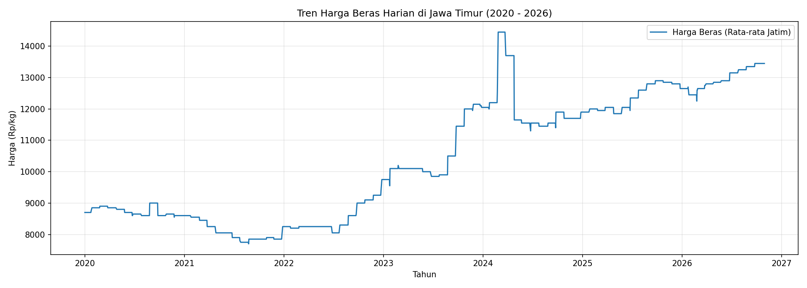
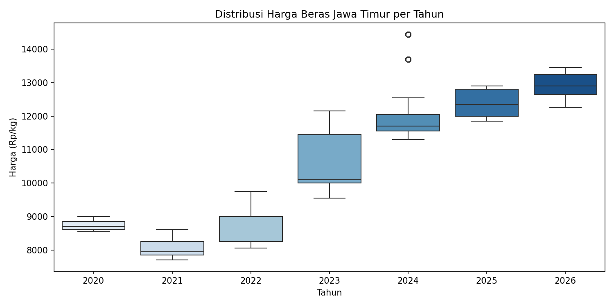
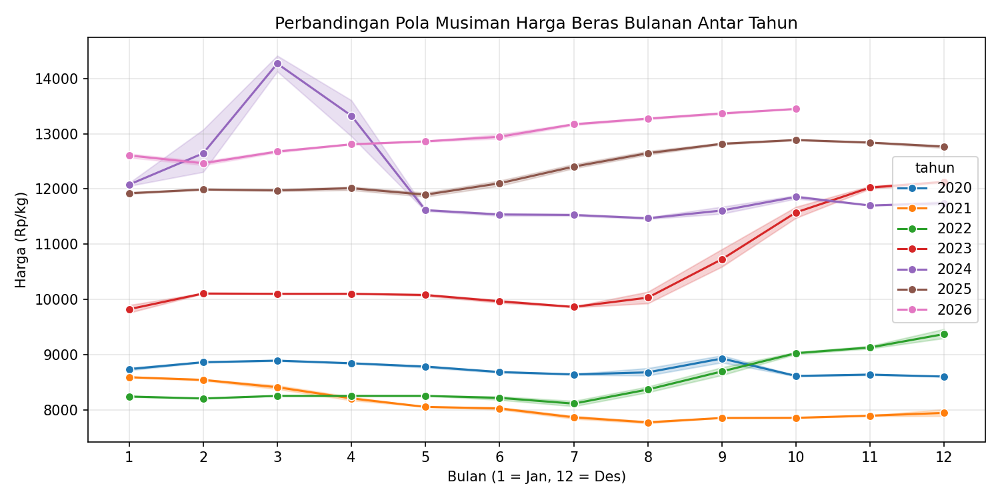

## INFORMASI PROYEK

**Judul Proyek:**  
Prediksi Harga Beras di Jawa Timur Menggunakan Pendekatan Time Series

**Nama Mahasiswa - NIM:** 
1. Riza Hanafi - 244311026
2. Dea Riftya A. - 244311008

**Program Studi:** D4 Teknologi Rekayasa Perangkat Lunak  
**Mata Kuliah:** Data Science  
**Dosen Pengampu:** Gus Nanang Syaifuddiin S.Kom., M.Kom.<br>
**Tahun Akademik:** 2026/2027 <br>
**Link GitHub Repository:** https://github.com/deariftyaa/Prediksi-Harga-Beras-Jawa-Timur  
**Link Video Pembahasan:** [URL Video (YouTube/Drive)]  
**SDG yang Dipilih:** SDG 2 - Tanpa Kelaparan (Zero Hunger)<br>
**Target SDG yang Relevan:** Target 2.c - Mengambil langkah-langkah untuk menjamin berfungsinya pasar komoditas pangan serta memfasilitasi akses tepat waktu terhadap informasi pasar, termasuk cadangan pangan, untuk membantu membatasi gejolak harga pangan yang ekstrem.

---

## 0. KERANGKA ML LIFECYCLE (L-M-O-P)

Laporan ini disusun mengikuti **ML Lifecycle** yang terdiri dari empat tahap berulang (iteratif):

| Tahap | Singkatan | Inti Pertanyaan | Bagian Laporan |
|-------|-----------|-----------------|----------------|
| **Learning Problem** | **L** | Apa target, objective, dan datanya? | Bab 2, 3, 4, 5 |
| **Model Design** | **M** | Model family/arsitektur apa, hypothesis space, dan inductive bias/asumsi apa? | Bab 6 (6.x.1 – 6.x.3) |
| **Optimization** | **O** | Bagaimana model dilatih: loss, optimizer, tuning, regularisasi, konvergensi? | Bab 6 (6.x.4 – 6.x.6) |
| **Predict & Evaluate** | **P** | Seberapa baik prediksi model berdasarkan metrik evaluasi? | Bab 7 |

```
   L (Learning Problem) ──► M (Model Design) ──► O (Optimization) ──► P (Predict & Evaluate)
          ▲                                                                   │
          └─────────────── iterasi / perbaikan berdasarkan hasil evaluasi ────┘
```

**Catatan untuk mahasiswa:** Setiap bagian diberi label **[L]**, **[M]**, **[O]**, atau **[P]**. Pastikan Anda dapat menjelaskan keterkaitan antar tahap, misalnya bagaimana hasil **P** mendorong perbaikan pada **L/M/O** (Bab 7.5).

---

## 1. LEARNING OUTCOMES

Pada proyek ini, mahasiswa diharapkan dapat:
1. **[L]** Mengidentifikasi masalah nyata dari **ide sendiri** yang selaras dengan salah satu tujuan **SDGs** ([Agenda 2030 – sdgs.un.org/2030agenda](https://sdgs.un.org/2030agenda)), lalu merumuskan problem statement (target, objective, data) secara jelas.
2. **[L]** Melakukan analisis dan eksplorasi data (EDA) secara komprehensif (**OPSIONAL**).
3. **[L]** Melakukan data preparation yang sesuai dengan karakteristik dataset.
4. **[M]** Merancang tiga model machine learning dengan justifikasi hypothesis space dan inductive bias (**WAJIB**):
   - Model baseline
   - Model machine learning / advanced
   - Model deep learning (**WAJIB**)
5. **[O]** Mengoptimasi model secara sistematis (loss function, optimizer, hyperparameter tuning, regularisasi).
6. **[P]** Menggunakan metrik evaluasi yang relevan dengan jenis tugas ML dan menganalisis hasilnya.
7. Melaporkan hasil eksperimen secara ilmiah dan sistematis.
8. Mengunggah seluruh kode proyek ke GitHub (**WAJIB**).
9. Menerapkan prinsip software engineering dalam pengembangan proyek.

---

## 2. PROJECT OVERVIEW  [L]

### 2.1 Latar Belakang

Beras merupakan komoditas pangan utama dan bahan pokok bagi mayoritas penduduk Indonesia, termasuk di Provinsi Jawa Timur yang dikenal sebagai salah satu lumbung beras nasional. Namun, menjelang Hari Besar Keagamaan Nasional (HBKN), khususnya Hari Raya Idul Fitri, dinamika harga beras di tingkat konsumen sering kali mengalami gejolak dan fluktuasi harga yang signifikan. Lonjakan harga ini dipicu oleh akumulasi beberapa faktor determinan, seperti lonjakan permintaan konsumen secara mendadak, perubahan pola distribusi logistik musiman, tren inflasi daerah, hingga keterbatasan pasokan akibat iklim cuaca yang memengaruhi jadwal panen.

Permasalahan fluktuasi harga komoditas pokok yang tidak terprediksi dengan cepat dapat menurunkan daya beli masyarakat secara drastis, khususnya pada lapisan ekonomi menengah ke bawah. Di tingkat makro, hal ini memicu stabilitas inflasi yang terganggu dan memperbesar risiko ketahanan pangan regional. Pemerintah daerah melalui Tim Pengendalian Inflasi Daerah (TPID) serta lembaga penyedia stok pangan seperti Perum BULOG memerlukan instrumen pendukung keputusan (*decision support system*) yang dapat memprediksi pergerakan harga beras secara presisi sebelum periode lonjakan terjadi.

Penerapan teknologi Machine Learning dan Deep Learning dalam pemodelan *time-series forecasting* menawarkan solusi ilmiah untuk menangkap pola temporal kompleks, efek musiman (*seasonality*), dan hubungan non-linear antar variabel ekonomi-iklim. Dengan tersedianya alat prediksi berakurasi tinggi, pemangku kebijakan dapat mengambil langkah intervensi pasar dini—seperti operasi pasar murah atau penyaluran cadangan beras pemerintah—secara terukur dan tepat waktu sebelum lonjakan ekstrim memicu kepanikan di masyarakat (*panic buying*).

**Referensi Ilmiah (Berformat APA):**
1. Hochreiter, S., & Schmidhuber, J. (1997). Long short-term memory. *Neural Computation*, 9(8), 1735–1780. https://doi.org/10.1162/neco.1997.9.8.1735
2. Chen, T., & Guestrin, C. (2016). XGBoost: A scalable tree boosting system. In *Proceedings of the 22nd ACM SIGKDD International Conference on Knowledge Discovery and Data Mining* (pp. 785–794). https://doi.org/10.1145/2939672.2939785
3. Badan Pusat Statistik & Bank Indonesia. (2023). *Laporan Panel Harga Pangan Nasional dan Analisis Pola Musiman Harga Komoditas Pokok Menjelang Hari Besar Keagamaan Nasional (HBKN)*. Jakarta: BI & BPS RI.

---

### 2.2 Keterkaitan dengan SDGs (WAJIB)

Ide proyek ini diinisiasi secara mandiri oleh mahasiswa dengan mengacu pada kerangka kerja pembangunan berkelanjutan global (*Sustainable Development Goals*).

| Komponen | Pertanyaan Panduan | Jawaban Anda |
|----------|--------------------|--------------|
| **SDG yang dipilih** | Goal nomor berapa dan apa namanya? | **SDG 2: Tanpa Kelaparan (Zero Hunger)** |
| **Target SDG** | Target mana yang paling relevan? | **Target 2.c:** Mengambil langkah-langkah untuk menjamin berfungsinya pasar komoditas pangan serta memfasilitasi akses tepat waktu terhadap informasi pasar, termasuk cadangan pangan, untuk membantu membatasi gejolak harga pangan yang ekstrem. |
| **Masalah nyata** | Masalah konkret apa yang diangkat? Siapa yang terdampak? | Gejolak dan lonjakan harga beras di Jawa Timur menjelang Idul Fitri yang menurunkan daya beli masyarakat berpenghasilan rendah dan memicu ketidakstabilan inflasi daerah. |
| **Peran ML** | Mengapa ML/DL cocok? Apa keputusan atau proses yang dibantu? | Pendekatan ML/DL mampu memodelkan ketergantungan sekuensial waktu jangka panjang (*long-term temporal dependencies*) dan variabel eksternal (hari libur/kalender keagamaan, iklim) yang tidak terstruktur secara linear. Hasil pemodelan membantu TPID dan BULOG dalam mengambil keputusan intervensi pasar secara preventif. |
| **Indikator kontribusi** | Bagaimana hasil model berkontribusi pada target SDG? | Menyediakan sistem peringatan dini (*early warning mechanism*) berupa proyeksi harga beras 30–60 hari ke depan, yang berkontribusi secara langsung pada pengurangan volatilitas ekstrim harga pangan di tingkat regional. |
| **Pertimbangan etika** | Risiko bias, privasi, atau dampak salah prediksi? | **Privasi:** Dataset menggunakan data publik agregat provinsi/kabupaten tanpa data individu.<br>**Dampak Prediksi:** Prediksi yang berlebihan (*overestimation*) berisiko memicu spekulasi pasar atau intervensi berlebihan. Oleh karena itu, model dilengkapi batas kepercayaan (*confidence margin*) agar interpretasi data tetap konfirmatif dan netral. |

**Sumber Ide:**  
Ide proyek muncul dari pengamatan terhadap fenomena tahunan lonjakan harga kebutuhan pokok menjelang Idul Fitri di pasar-pasar tradisional Jawa Timur, serta dorongan untuk memanfaatkan keterbukaan data (*open data*) Bank Indonesia (PIHPS) dan BPS demi menghasilkan solusi teknologi nyata bagi stabilitas pangan lokal.

---

### 2.3 Ringkasan Alur Lifecycle Proyek

Proyek ini dilaksanakan secara terstruktur melalui empat tahapan ML Lifecycle berulang (L → M → O → P). Pada tahap **Learning Problem [L]**, target pergerakan harga harian beras dirumuskan berdasarkan data deret waktu historis (2018–2025) beserta pembentukan fitur lag dan kalender Idul Fitri. Pada tahap **Model Design [M]**, dirancang tiga arsitektur model berskala gradual: SARIMAX (baseline linear time-series), XGBoost Regressor (advanced tree-based ML), dan LSTM/GRU (deep learning sequential network). Tahap **Optimization [O]** berfokus pada tuning hyperparameter, peminjaman struktur window data temporal, serta pencegahan overfitting dengan regularisasi (dropout dan early stopping). Hasil prediksi dievaluasi pada tahap **Predict & Evaluate [P]** menggunakan metrik RMSE, MAE, dan MAPE pada data *hold-out test set* menjelang Idul Fitri. Temuan galat evaluasi di tahap P selanjutnya digunakan sebagai sarana iterasi perbaikan terhadap rekayasa fitur di tahap L dan penyetelan ulang arsitektur di tahap M/O.

---

## 3. BUSINESS UNDERSTANDING / PROBLEM UNDERSTANDING  [L]

### 3.1 Problem Statements

1. **Fluktuasi Harga Musiman:** Bagaimana merumuskan model prediksi yang mampu menangkap pola tren temporal dan lonjakan harga beras harian/mingguan di Jawa Timur secara akurat menjelang periode puncak Idul Fitri?
2. **Kualitas & Karakteristik Data Time-Series:** Bagaimana mengolah data historis deret waktu harga beras yang memiliki ketidakberaturan pola kalender keagamaan (tahun Hijriah yang bergeser dalam kalender Masehi) agar siap dilatih oleh algoritma Machine Learning dan Deep Learning?
3. **Komparasi Kinerja Arsitektur:** Sejauh mana efektivitas perbandingan antara model statistik linier konvensional (SARIMAX), model berbasis pohon ensemble (XGBoost), dan arsitektur recurrent neural network (LSTM/GRU) dalam meminimumkan persentase kesalahan prediksi (*error rate*) pada horizon waktu 30–60 hari?

---

### 3.2 Formulasi Learning Problem (WAJIB)

| Komponen | Pertanyaan Panduan | Jawaban Anda |
|----------|--------------------|--------------|
| **Target** | Apa yang diprediksi? Jenis tugas? | • **Target Prediksi ($y_t$):** Harga rerata beras kualitas medium/super di tingkat konsumen Jawa Timur (IDR/kg) pada waktu $t$.<br>• **Jenis Tugas ML:** *Time-Series Forecasting / Continuous Regression*. |
| **Objective** | Apa yang dioptimalkan/diminimalkan secara matematis? Metrik utama? | • **Mathematical Objective:** Meminimalkan *Mean Squared Error* (MSE) / *Loss Function* antara harga aktual ($y_t$) dan harga hasil prediksi ($\hat{y}_t$) pada horizon waktu pengujian.<br>• **Metrik Evaluasi Utama:** Root Mean Squared Error (RMSE), Mean Absolute Error (MAE), dan Mean Absolute Percentage Error (MAPE). |
| **Data** | Sumber, ukuran, jenis, dan asumsi data? | • **Sumber:** Pusat Informasi Harga Pangan Strategis (PIHPS) Nasional / Bank Indonesia & BPS Jawa Timur.<br>• **Ukuran Data:** Deret waktu harian/mingguan dari tahun 2018 hingga 2025 (sekitar 1.500–2.500 baris data temporal).<br>• **Tipe Data:** *Tabular Time-Series Data*.<br>• **Asumsi Data:** Data memiliki komponen tren, musiman (*seasonality*), dan tidak terdistribusi secara independent and identically distributed (i.i.d.) melainkan memiliki ketergantungan temporal (*autocorrelation*). Splitting dilakukan berbasis temporal (bukan random split) untuk mencegah data leakage. |

---

### 3.3 Goals

1. **Akurasi Model Prediksi:** Membangun model machine learning dan deep learning yang mampu memprediksi harga beras harian di Jawa Timur dengan tingkat kesalahan persentase rata-rata (MAPE) di bawah 5% pada data pengujian test set.
2. **Komparasi Arsitektur Multi-Model:** Menganalisis dan mengevaluasi keunggulan serta keterbatasan dari tiga kelompok model (*Baseline SARIMAX*, *Advanced XGBoost*, dan *Deep Learning LSTM*) dalam memodelkan lonjakan harga menjelang hari raya.
3. **Penanganan Variabel Temporal Khusus:** Menerapkan teknik *feature engineering* temporal yang presisi (termasuk variabel *lag*, *rolling mean*, dan indikator jarak H-minus/plus Idul Fitri) untuk meningkatkan performa prediksi.
4. **Kontribusi Pencapaian SDG 2 Target 2.c:** Menghasilkan prototype sistem perkiraan harga beras yang transparan dan *reproducible* untuk mendukung pengambilan keputusan preventif oleh pemangku kepentingan stabilisasi pangan di Jawa Timur.

---

### 3.4 Solution Approach  [M]

Dalam proyek ini, dilakukan eksperimen komparatif menggunakan tiga arsitektur model dengan karakteristik *hypothesis space* dan *inductive bias* yang berbeda:

#### Model 1 – Baseline Model
* **Model yang Dipilih:** **SARIMAX (Seasonal Autoregressive Integrated Moving Average with Exogenous Variables)**
* **Alasan Pemilihan:**  
  SARIMAX dipilih sebagai baseline karena merupakan standar baku dalam analisis deret waktu linier klasik. Model ini secara khusus dirancang untuk menangani data temporal yang memiliki tren (*differencing/I*), keterkaitan autoregresif (*AR*), komponen *moving average* (*MA*), serta faktor musiman berulang (*Seasonal*) dan variabel eksogenus tambahan (*X*, seperti dummy Idul Fitri). Evaluasi SARIMAX menjadi benchmark awal untuk mengukur sejauh mana model non-linear nantinya memberikan peningkatan performa.

#### Model 2 – Advanced / ML Model
* **Model yang Dipilih:** **XGBoost Regressor (Extreme Gradient Boosting)**
* **Alasan Pemilihan:**  
  XGBoost dipilih sebagai perwakilan model Machine Learning tingkat lanjut berbasis *ensemble decision trees*. XGBoost sangat efektif pada data tabular berakurasi tinggi, memiliki algoritma *tree-boosting* yang cepat, serta terbukti robust terhadap *outliers*. Dengan menyusun data deret waktu menjadi bentuk *supervised learning* melalui pembentukan fitur *lag* dan *rolling statistics*, XGBoost mampu menangkap interaksi non-linear yang rumit antara fitur kalender, tren sejarah harga, dan variabel eksogen tanpa memerlukan asumsi distribusi data yang ketat.

#### Model 3 – Deep Learning Model (WAJIB)
* **Model yang Dipilih:** **Long Short-Term Memory (LSTM) Neural Network**
* **Kategori Implementasi:** D. Time Series (Sequential Prediction)
* **Alasan Pemilihan:**  
  LSTM merupakan varian dari *Recurrent Neural Network* (RNN) yang dirancang khusus untuk mengatasi masalah *vanishing gradient* pada data sekuensial berjarak panjang. Arsitektur LSTM memanfaatkan struktur *gate* internal (*input gate*, *forget gate*, dan *output gate*) serta *cell state* untuk mengingat atau melupakan informasi rentang waktu historis secara selektif. Hal ini membuat LSTM sangat ideal untuk mempelajari dinamika kompleks pergerakan harga beras dalam pola jangka panjang dan fluktuasi mendadak saat memasuki bulan Ramadan hingga Idul Fitri.

**Minimum Requirements Compliance untuk Deep Learning:**
- Model dilatih dengan jumlah *epoch* minimum $\ge 10$ epoch (direncanakan 50–100 epoch dengan *EarlyStopping*).
- Menyajikan visualisasi kurva *training loss* vs *validation loss* per epoch.
- Melakukan evaluasi dan prediksi langsung pada data *hold-out test set* temporal.
- Mencatat dan melaporkan *training computation time* secara aktual.

## 4. DATA UNDERSTANDING  **[L]**
### 4.1 Informasi Dataset
**Sumber Dataset:**  
Pusat Informasi Harga Pangan Strategis Nasional (PIHPS Nasional) — Bank Indonesia, wilayah Provinsi Jawa Timur (URL: https://www.bi.go.id/hargapangan). Dataset diunduh secara terpisah per tahun dari tahun 2020 hingga 2026 (`2020.xlsx` s.d. `2026.xlsx`) dengan rentang pencatatan 1 Januari 2020 hingga 30 Oktober 2026 (hari kerja Senin–Jumat).

**Deskripsi Dataset:**
- Jumlah baris (rows): 1.783 baris observasi harian (setelah penggabungan dan transformasi dari *wide format* ke *long format*)
- Jumlah kolom (columns/features): 3 kolom utama (`tanggal`, `harga_beras`, `harga_beras_medium1`)
- Tipe data: Time Series (Tabular Deret Waktu)
- Ukuran dataset: 58,72 KB (0,057 MB) untuk 7 berkas Excel mentah
- Format file: XLSX (`.xlsx`) pada sumber mentah, dan CSV (`.csv`) setelah penggabungan

### 4.2 Deskripsi Fitur
| Nama Fitur | Tipe Data | Deskripsi | Contoh Nilai |
|------------|-----------|-----------|--------------|
| tanggal | Datetime (`datetime64[ns]`) | Tanggal pencatatan harga pasar harian komoditas di Provinsi Jawa Timur (hari kerja Senin–Jumat). | `2020-01-01`, `2024-02-26`, `2026-10-30` |
| harga_beras | Float (`float64`) | **Variabel Target ($y$):** Harga rata-rata komoditas Beras di Provinsi Jawa Timur (dalam satuan Rupiah/kg). | `8700.0`, `12100.0`, `14450.0` |
| harga_beras_medium1 | Float (`float64`) | Harga rata-rata komoditas Beras Kualitas Medium I di Provinsi Jawa Timur (dalam satuan Rupiah/kg), memiliki korelasi sangat tinggi ($r = 0,9995$) dengan variabel target. | `8500.0`, `12050.0`, `14450.0` |

### 4.3 Kondisi Data

- **Missing Values:** Ada, sebanyak 1 baris observasi (0,056% dari total 1.783 baris), yaitu pada tanggal `2022-02-28` yang tercatat sebagai karakter `'-'` karena bertepatan dengan hari libur nasional.
- **Duplicate Data:** Tidak ada (0 baris duplikat pada indeks tanggal setelah penggabungan seluruh 7 berkas tahunan).
- **Outliers:** Tidak ada outlier ekstrem berdasarkan metode *Interquartile Range* (IQR). Dengan $Q_1 = \text{Rp}8.600$, $Q_3 = \text{Rp}12.050$, dan $\text{IQR} = \text{Rp}3.450$, batas bawah berada pada $\text{Rp}3.425$ dan batas atas pada $\text{Rp}17.225$, sedangkan seluruh nilai berada pada rentang $\text{Rp}7.700\text{–Rp}14.450$.
- **Imbalanced Data:** Tidak berlaku, karena permasalahan ini merupakan regresi deret waktu (*time series forecasting*) dengan target numerik kontinu, bukan klasifikasi kelas diskrit.
- **Noise:** Ditemukan pola *step-change* (lonjakan perubahan harga harian yang tajam namun tetap stabil di level baru) yang sering muncul di sekitar tanggal 25 setiap bulannya pada pencatatan PIHPS (misalnya lonjakan $+\text{Rp}1.900$ pada `2024-02-26` dan penurunan $-\text{Rp}2.050$ pada `2024-04-25`).
- **Data Quality Issues:** Pada berkas mentah `.xlsx`, tanggal tersimpan sebagai header kolom (*wide format*) dan nilai harga bertipe teks (*string*) dengan pemisah ribuan tanda koma (contoh: `'8,700'`), sehingga memerlukan proses *unpivoting* dan konversi tipe data numerik.
- **Asumsi Data (i.i.d., distribusi train-test, potensi data leakage):** Data deret waktu melanggar asumsi *independent and identically distributed* (i.i.d.) karena terdapat autokorelasi temporal yang kuat antar hari. Selain itu, terjadi pergeseran distribusi (*distribution shift*) di mana rata-rata harga tahun 2020–2022 berkisar di $\text{Rp}8.078\text{–Rp}8.738/\text{kg}$, sedangkan pada 2023–2026 meningkat ke level $\text{Rp}10.540\text{–Rp}12.968/\text{kg}$. Potensi *data leakage* muncul jika pembagian data dilakukan secara acak (*random split*), fitting *scaler* dilakukan sebelum *splitting*, atau fitur `harga_beras_medium1` pada hari-$t$ dipakai langsung tanpa *lag* untuk memprediksi `harga_beras` pada hari-$t$.

### 4.4 Exploratory Data Analysis (EDA)

#### Visualisasi 1: Tren Harga Beras Harian di Jawa Timur (2020–2026)


**Insight:**  
Harga beras di Jawa Timur cenderung stabil rendah sepanjang tahun 2020 hingga pertengahan 2022 di kisaran $\text{Rp}7.700\text{–Rp}9.000/\text{kg}$. Namun, mulai akhir 2022 hingga awal 2024 terjadi tren kenaikan struktural (*structural break*) yang tajam hingga mencapai titik puncak tertinggi sebesar $\text{Rp}14.450/\text{kg}$ pada akhir Februari 2024 akibat gangguan pasokan dan mundurnya masa panen raya (dampak El Niño), sebelum akhirnya terkoreksi dan stabil pada kisaran baru $\text{Rp}11.300\text{–Rp}13.450/\text{kg}$ pada periode 2024–2026.

#### Visualisasi 2: Boxplot Distribusi Harga Beras per Tahun


**Insight:**  
Sebaran harga antar tahun menunjukkan perubahan varians yang signifikan. Tahun 2020 memiliki rentang harga paling sempit ($\text{std} = \text{Rp}131,12$), sementara tahun 2023 ($\text{std} = \text{Rp}842,76$) dan 2024 ($\text{std} = \text{Rp}901,53$) memiliki rentang interkuartil paling lebar akibat tingginya volatilitas pasokan beras nasional. Tidak ditemukan titik pencilan ekstrem di luar batas whisker IQR pada masing-masing tahun.

#### Visualisasi 3: Perbandingan Pola Musiman Harga Beras Bulanan Antar Tahun


**Insight:**  
Secara musiman, kenaikan harga beras konsisten terjadi pada kuartal pertama (Januari–Maret) yang bertepatan dengan periode paceklik/pra-panen raya di sentra produksi padi. Setelah memasuki kuartal kedua (April–Juni), harga cenderung melandai atau terkoreksi seiring masuknya musim panen raya di Jawa Timur, lalu kembali merangkak naik secara bertahap pada paruh kedua tahun (Juli–Desember).

---

## 5. DATA PREPARATION  **[L]**

### 5.1 Data Cleaning
```
Restrukturisasi Tabel (Unpivoting):
- Kondisi awal: 7 berkas Excel berformat wide (tanggal sebagai kolom)
- Strategi: Melakukan iterasi kolom tanggal pada setiap berkas dan menggabungkannya secara kronologis (long format)
- Alasan: Model time series dan supervised regression membutuhkan struktur observasi vertikal yang terurut berdasarkan waktu
Konversi Tipe Data:
- Kondisi awal: Kolom harga bertipe object/string dengan tanda koma ribuan (contoh: '8,700')
- Strategi: Menghapus karakter koma (',') dan mengonversi nilai ke tipe float64
- Alasan: Operasi matematis, perhitungan statistik, dan algoritma ML membutuhkan representasi numerik kontinu
Missing Values:
- Kondisi awal: Fitur 'harga_beras' dan 'harga_beras_medium1' memiliki 1 missing value (0,056%) pada tanggal 2022-02-28 (berisi '-')
- Strategi: Imputasi menggunakan metode Forward Fill (ffill) dari nilai hari kerja sebelumnya (2022-02-25)
- Alasan: Pada hari libur pasar, harga acuan mengikuti harga penutupan hari bursa terakhir dan ffill mencegah kebocoran informasi dari masa depan (no data leakage)
Duplicate Data & Outliers:
- Kondisi awal: Ditemukan 0 duplikat tanggal dan 0 outlier ekstrem berdasarkan uji IQR
- Strategi: Tidak dilakukan penghapusan baris outlier
- Alasan: Lonjakan harga pada awal tahun 2024 merupakan dinamika pasar nyata yang harus dipelajari oleh model
```

### 5.2 Feature Engineering
- **Pembuatan Fitur Autoregressive (*Lag Features*):** Membentuk fitur `lag_1`, `lag_3`, `lag_7`, `lag_14`, dan `lag_30` dari variabel target `harga_beras`, serta `lag_1_med1` dari `harga_beras_medium1`. Seluruh fitur menggunakan nilai masa lalu ($\ge t-1$) agar tidak terjadi *data leakage* saat memprediksi hari-$t$.
- **Pembuatan Fitur Kalender & Siklus Musiman:** Mengekstrak fitur `bulan` (1–12), `hari_dalam_minggu` (0–4), dan `hari_dalam_bulan` (1–31, untuk menangkap pola penyesuaian harga bulanan di sekitar tanggal 25).
- **Pembersihan Baris Awal (*Trimming*):** Menghapus 30 baris observasi paling awal (`2020-01-01` s.d. `2020-02-11`) yang mengandung nilai `NaN` akibat pergeseran `lag_30`, sehingga tersisa **1.753 baris** data bersih siap pakai dengan total **12 fitur masukan**.

### 5.3 Data Transformation

- **Lag Features & Rolling Statistics:** Selain *lag* harian, dihitung statistik bergerak (*rolling window*) berbasis `harga_beras.shift(1)` berupa rata-rata bergerak 7 hari (`rolling_mean_7`), standar deviasi 7 hari (`rolling_std_7`), dan rata-rata bergerak 30 hari (`rolling_mean_30`) untuk menangkap tren jangka pendek dan jangka menengah.
- **Scaling (`MinMaxScaler`):** Seluruh 12 fitur numerik dan variabel target diskalakan ke rentang $[0, 1]$ menggunakan `MinMaxScaler`. Proses `fit()` dilakukan **secara eksklusif hanya pada data training** (`train_df`), kemudian parameternya diterapkan (`transform()`) pada `val_df` dan `test_df` untuk menjamin kestabilan konvergensi gradien pada model *Deep Learning* (LSTM) tanpa *data leakage*.
- **Time Windows (Untuk Deep Learning):** Pada pemodelan sekuensial (LSTM), data tabular yang telah diskalakan akan dibentuk menjadi tensor 3 dimensi `(samples, time_steps, features)` dengan jendela waktu (*lookback window*) $T = 14$ hari kerja terakhir untuk memprediksi harga pada hari berikutnya.

### 5.4 Data Splitting

**Strategi pembagian data:**
```
- Training set: 70% (1.227 samples) -> periode 2020-02-12 s.d. 2024-10-11
- Validation set: 15% (263 samples) -> periode 2024-10-14 s.d. 2025-10-21
- Test set: 15% (263 samples) -> periode 2025-10-22 s.d. 2026-10-30

Karena dataset merupakan data deret waktu (*time series*), pembagian data dilakukan menggunakan **Chronological Split** secara berurutan tanpa pengacakan (`shuffle=False`). Pengacakan data pada *time series* akan menyebabkan kebocoran informasi masa depan ke masa lalu (*look-ahead bias*). Pembagian 70% : 15% : 15% memastikan bahwa:
1. **Training set** mencakup dinamika jangka panjang tahun 2020–2024 termasuk fase pergeseran harga (*structural break*).
2. **Validation set** mencakup satu siklus tahunan penuh (Oktober 2024 – Oktober 2025) untuk evaluasi model awal dan *hyperparameter tuning*.
3. **Test set** mencakup satu siklus tahunan berikutnya (Oktober 2025 – Oktober 2026) dan disimpan terpisah (*untouched*) hingga tahap evaluasi akhir di Minggu 6.

### 5.5 Data Balancing
Tidak dilakukan teknik *data balancing* (seperti SMOTE maupun *undersampling*) karena permasalahan ini merupakan tugas **regresi kontinu** (*time series forecasting*) untuk memprediksi besaran harga dalam Rupiah, bukan tugas klasifikasi yang memiliki ketidakseimbangan kelas kategorikal.

### 5.6 Ringkasan Data Preparation

1. **Apa yang dilakukan:**
   Melakukan penggabungan 7 berkas Excel tahunan menjadi format *long table* kronologis, membersihkan pemisah koma ribuan menjadi `float64`, mengimputasi 1 nilai kosong dengan *forward fill*, membentuk 12 fitur rekayasa waktu (*lag*, *rolling statistics*, dan fitur kalender), membagi data secara kronologis (70% Train, 15% Validation, 15% Test), serta menormalisasi fitur ke rentang $[0, 1]$ menggunakan `MinMaxScaler`.
2. **Mengapa penting:**
   Data mentah PIHPS berformat *wide* dan bertipe string sehingga tidak dapat langsung diproses oleh algoritma pembelajaran mesin. Pembuatan fitur *lag* dan *rolling window* memberikan konteks historis serta siklus musiman bulanan bagi model tabular, sementara *chronological split* dan *fitting scaler* eksklusif pada *training set* mencegah terjadinya *data leakage* agar evaluasi performa model benar-benar mencerminkan kondisi peramalan di dunia nyata.
3. **Bagaimana implementasinya:**
   Seluruh pipeline diimplementasikan secara terstruktur dan *reproducible* menggunakan pustaka `pandas`, `numpy`, dan `scikit-learn` (`MinMaxScaler`) di dalam notebook `01_learning_problem_eda.ipynb` dan `02_data_preparation.ipynb`. Hasil akhir disimpan ke dalam berkas terpisah (`train.csv`, `val.csv`, `test.csv`, dan `scalers.pkl`) agar konsisten digunakan pada tahap pemodelan berikutnya.

---

## 6. MODELING  **[M + O]**

> Setiap model (6.1, 6.2, 6.3) dijelaskan dalam dua fase: **Model Design [M]** (sub-bagian .1–.3) dan **Optimization [O]** (sub-bagian .4–.6).

### 6.1 Model 1 — Baseline Model

#### 6.1.1 Deskripsi Model  **[M]**

**Nama Model:** [Nama model, misal: Logistic Regression]  
**Teori Singkat:**  
[Jelaskan secara singkat bagaimana model ini bekerja]  
**Alasan Pemilihan:**  
[Mengapa memilih model ini sebagai baseline?]

#### 6.1.2 Hypothesis Space & Inductive Bias  **[M]**

- **Model family / arsitektur:** [misal: model linear]
- **Hypothesis space:** [himpunan fungsi yang dapat direpresentasikan, misal: batas keputusan linear]
- **Inductive bias / asumsi:** [misal: hubungan fitur-target linear, fitur independen]
- **Implikasi terhadap dataset Anda:** [apakah asumsi cocok dengan data?]

#### 6.1.3 Implementasi (Ringkas)  **[M]**
```python
# Contoh kode (opsional, bisa dipindah ke GitHub)
from sklearn.linear_model import LogisticRegression

model_baseline = LogisticRegression(C=1.0, max_iter=100)
model_baseline.fit(X_train, y_train)
y_pred_baseline = model_baseline.predict(X_test)
```

#### 6.1.4 Optimization: Objective, Hyperparameter & Regularisasi  **[O]**

**Objective/loss yang dioptimalkan:** [misal: log-loss + L2]  
**Parameter yang digunakan:**
```
[Tuliskan parameter penting, contoh:]
- C (regularization): 1.0
- solver: 'lbfgs'
- max_iter: 100
```

#### 6.1.5 Hasil Awal  **[O → P]**

**[Tuliskan hasil awal pada validation set; evaluasi akhir pada test set dijelaskan di Bab 7]**

---

### 6.2 Model 2 — ML / Advanced Model

#### 6.2.1 Deskripsi Model  **[M]**

**Nama Model:** [Nama model, misal: Random Forest / XGBoost]  
**Teori Singkat:**  
[Jelaskan bagaimana algoritma ini bekerja]

**Alasan Pemilihan:**  
[Mengapa memilih model ini?]

**Keunggulan:**
- [Sebutkan keunggulan]

**Kelemahan:**
- [Sebutkan kelemahan]

#### 6.2.2 Hypothesis Space & Inductive Bias  **[M]**

- **Model family / arsitektur:** [misal: ensemble pohon keputusan]
- **Hypothesis space:** [fungsi non-linear piecewise, interaksi fitur otomatis, dll.]
- **Inductive bias / asumsi:** [misal: data tabular dengan struktur ambang/threshold]
- **Perbandingan dengan baseline:** [apa yang bisa dipelajari model ini yang tidak bisa baseline?]

#### 6.2.3 Implementasi (Ringkas)  **[M]**
```python
# Contoh kode
from sklearn.ensemble import RandomForestClassifier

model_advanced = RandomForestClassifier(
    n_estimators=100,
    max_depth=10,
    random_state=42
)
model_advanced.fit(X_train, y_train)
y_pred_advanced = model_advanced.predict(X_test)
```

#### 6.2.4 Optimization: Hyperparameter Tuning  **[O]**

**Parameter yang digunakan:**
```
[Tuliskan parameter penting, contoh:]
- n_estimators: 100
- max_depth: 10
- learning_rate: 0.1
- min_samples_split: 2
```

**Hyperparameter Tuning (WAJIB minimal 1 metode sederhana):**
- Metode: [Grid Search / Random Search / Bayesian Optimization]
- Search space: [rentang parameter yang dicoba]
- Skema validasi: [k-fold CV / validation set]
- Best parameters: [...]
- Skor validasi sebelum vs sesudah tuning: [...]

#### 6.2.5 Kontrol Overfitting  **[O]**
[Jelaskan regularisasi/pembatasan kompleksitas yang dipakai, misal: max_depth, min_samples_leaf, early stopping pada boosting]

#### 6.2.6 Hasil Model  **[O → P]**

**[Tuliskan hasil pada validation set; evaluasi akhir dijelaskan di Bab 7]**

---

### 6.3 Model 3 — Deep Learning Model (WAJIB)

#### 6.3.1 Deskripsi Model  **[M]**

**Nama Model:** [Nama arsitektur, misal: CNN / LSTM / MLP]

** (Centang) Jenis Deep Learning: **
- [ ] Multilayer Perceptron (MLP) - untuk tabular
- [ ] Convolutional Neural Network (CNN) - untuk image
- [ ] Recurrent Neural Network (LSTM/GRU) - untuk sequential/text
- [ ] Transfer Learning - untuk image
- [ ] Transformer-based - untuk NLP
- [ ] Autoencoder - untuk unsupervised
- [ ] Neural Collaborative Filtering - untuk recommender

**Alasan Pemilihan:**  
[Mengapa arsitektur ini cocok untuk dataset Anda?]

#### 6.3.2 Arsitektur Model, Hypothesis Space & Inductive Bias  **[M]**

**Inductive bias arsitektur:** [misal: CNN → lokalitas & translation invariance; LSTM → ketergantungan sekuensial; MLP → tanpa asumsi struktur]  
**Hypothesis space:** [kapasitas model: jumlah layer, unit, parameter]

**Deskripsi Layer:**

[Jelaskan arsitektur secara detail atau buat tabel]

**Contoh:**
```
1. Input Layer: shape (224, 224, 3)
2. Conv2D: 32 filters, kernel (3,3), activation='relu'
3. MaxPooling2D: pool size (2,2)
4. Conv2D: 64 filters, kernel (3,3), activation='relu'
5. MaxPooling2D: pool size (2,2)
6. Flatten
7. Dense: 128 units, activation='relu'
8. Dropout: 0.5
9. Dense: 10 units, activation='softmax'

Total parameters: [jumlah]
Trainable parameters: [jumlah]
```

#### 6.3.3 Input & Preprocessing Khusus  **[M]**

**Input shape:** [Sebutkan dimensi input]  
**Preprocessing khusus untuk DL:**
- [Sebutkan preprocessing khusus seperti normalisasi, augmentasi, dll.]

#### 6.3.4 Optimization: Konfigurasi Training  **[O]**

**Training Configuration:**
```
- Optimizer: Adam / SGD / RMSprop
- Learning rate: [nilai]
- Loss function: [categorical_crossentropy / mse / binary_crossentropy / etc.]
- Metrics: [accuracy / mae / etc.]
- Batch size: [nilai]
- Epochs: [nilai]
- Validation split: [nilai] atau menggunakan validation set terpisah
- Callbacks: [EarlyStopping, ModelCheckpoint, ReduceLROnPlateau, etc.]
- Regularisasi: [Dropout / L2 / BatchNorm / augmentasi]
```

**Eksperimen optimasi (minimal 2 konfigurasi dibandingkan):**

| Eksperimen | Learning Rate | Batch Size | Regularisasi | Val Loss | Val Metric |
|------------|---------------|------------|--------------|----------|------------|
| Exp-1 | [ ] | [ ] | [ ] | [ ] | [ ] |
| Exp-2 | [ ] | [ ] | [ ] | [ ] | [ ] |

#### 6.3.5 Implementasi (Ringkas)  **[M + O]**

**Framework:** TensorFlow/Keras / PyTorch
```python
# Contoh kode TensorFlow/Keras
import tensorflow as tf
from tensorflow import keras

model_dl = keras.Sequential([
    keras.layers.Dense(128, activation='relu', input_shape=(input_dim,)),
    keras.layers.Dropout(0.3),
    keras.layers.Dense(64, activation='relu'),
    keras.layers.Dropout(0.3),
    keras.layers.Dense(num_classes, activation='softmax')
])

model_dl.compile(
    optimizer='adam',
    loss='categorical_crossentropy',
    metrics=['accuracy']
)

history = model_dl.fit(
    X_train, y_train,
    validation_split=0.2,
    epochs=50,
    batch_size=32,
    callbacks=[early_stopping]
)
```

#### 6.3.6 Training Process & Diagnosis Optimasi  **[O]**

**Training Time:**  
[Sebutkan waktu training total, misal: 15 menit]

**Computational Resource:**  
[CPU / GPU, platform: Local / Google Colab / Kaggle]

**Training History Visualization:**

[Insert plot loss dan accuracy/metric per epoch]

**Contoh visualisasi yang WAJIB:**
1. **Training & Validation Loss** per epoch
2. **Training & Validation Accuracy/Metric** per epoch

**Analisis Training:**
- Apakah model mengalami overfitting? [Ya/Tidak, jelaskan]
- Apakah model sudah converge? [Ya/Tidak, jelaskan]
- Apakah perlu lebih banyak epoch? [Ya/Tidak, jelaskan]
- Apakah learning rate sesuai (loss stabil/osilasi/lambat)? [Jelaskan]

#### 6.3.7 Model Summary
```
[Paste model.summary() output atau rangkuman arsitektur]
```

---

## 7. EVALUATION  **[P]**

### 7.1 Metrik Evaluasi

**Pilih metrik yang sesuai dengan jenis tugas:**

#### **Untuk Klasifikasi:**
- **Accuracy**: Proporsi prediksi yang benar
- **Precision**: TP / (TP + FP)
- **Recall**: TP / (TP + FN)
- **F1-Score**: Harmonic mean dari precision dan recall
- **ROC-AUC**: Area under ROC curve
- **Confusion Matrix**: Visualisasi prediksi

#### **Untuk Regresi:**
- **MSE (Mean Squared Error)**: Rata-rata kuadrat error
- **RMSE (Root Mean Squared Error)**: Akar dari MSE
- **MAE (Mean Absolute Error)**: Rata-rata absolute error
- **R² Score**: Koefisien determinasi
- **MAPE (Mean Absolute Percentage Error)**: Error dalam persentase

#### **Untuk NLP (Text Classification):**
- **Accuracy**
- **F1-Score** (terutama untuk imbalanced data)
- **Precision & Recall**
- **Perplexity** (untuk language models)

#### **Untuk Computer Vision:**
- **Accuracy**
- **IoU (Intersection over Union)** - untuk object detection/segmentation
- **Dice Coefficient** - untuk segmentation
- **mAP (mean Average Precision)** - untuk object detection

#### **Untuk Clustering:**
- **Silhouette Score**
- **Davies-Bouldin Index**
- **Calinski-Harabasz Index**

#### **Untuk Recommender System:**
- **RMSE**
- **Precision@K**
- **Recall@K**
- **NDCG (Normalized Discounted Cumulative Gain)**

**Justifikasi pemilihan metrik:** [Mengapa metrik ini selaras dengan Objective di Bab 3.2? Mengapa accuracy saja cukup/tidak cukup?]

### 7.2 Hasil Evaluasi Model (pada Test Set)

> Semua prediksi dievaluasi pada **test set** yang tidak pernah dipakai saat training maupun tuning.

#### 7.2.1 Model 1 (Baseline)

**Metrik:**
```
[Tuliskan hasil metrik, contoh:]
- Accuracy: 0.75
- Precision: 0.73
- Recall: 0.76
- F1-Score: 0.74
```

**Confusion Matrix / Visualization:**  
[Insert gambar jika ada]

#### 7.2.2 Model 2 (Advanced/ML)

**Metrik:**
```
- Accuracy: 0.85
- Precision: 0.84
- Recall: 0.86
- F1-Score: 0.85
```

**Confusion Matrix / Visualization:**  
[Insert gambar jika ada]

**Feature Importance (jika applicable):**  
[Insert plot feature importance untuk tree-based models]

#### 7.2.3 Model 3 (Deep Learning)

**Metrik:**
```
- Accuracy: 0.89
- Precision: 0.88
- Recall: 0.90
- F1-Score: 0.89
```

**Confusion Matrix / Visualization:**  
[Insert gambar jika ada]

**Training History:**  
[Sudah diinsert di Section 6.3.6]

**Test Set Predictions:**  
[Tampilkan minimal 5 contoh prediksi benar dan salah]

### 7.3 Perbandingan Ketiga Model

**Tabel Perbandingan:**

| Model | Accuracy | Precision | Recall | F1-Score | Training Time | Inference Time |
|-------|----------|-----------|--------|----------|---------------|----------------|
| Baseline (Model 1) | 0.75 | 0.73 | 0.76 | 0.74 | 2s | 0.01s |
| Advanced (Model 2) | 0.85 | 0.84 | 0.86 | 0.85 | 30s | 0.05s |
| Deep Learning (Model 3) | 0.89 | 0.88 | 0.90 | 0.89 | 15min | 0.1s |

**Visualisasi Perbandingan:**  
[Insert bar chart atau plot perbandingan metrik]

### 7.4 Analisis Hasil

**Interpretasi:**

1. **Model Terbaik:**  
   [Sebutkan model mana yang terbaik dan mengapa]

2. **Perbandingan dengan Baseline:**  
   [Jelaskan peningkatan performa dari baseline ke model lainnya]

3. **Trade-off:**  
   [Jelaskan trade-off antara performa vs kompleksitas vs waktu training]

4. **Error Analysis:**  
   [Jelaskan jenis kesalahan yang sering terjadi, kasus yang sulit diprediksi]

5. **Overfitting/Underfitting & Generalization Gap:**  
   [Bandingkan performa train vs validation vs test; analisis apakah model overfitting atau underfitting]

6. **Kesesuaian Inductive Bias:**  
   [Apakah asumsi tiap model (Bab 6.x.2) terbukti sesuai dengan data? Jelaskan dengan bukti hasil]

### 7.5 Umpan Balik Lifecycle (Iterasi L → M → O)

Jelaskan minimal **satu** iterasi perbaikan berdasarkan hasil evaluasi:

| Temuan dari Evaluasi [P] | Tahap yang Diperbaiki | Tindakan | Dampak pada Metrik |
|--------------------------|-----------------------|----------|--------------------|
| [misal: recall kelas minoritas rendah] | [L] data | [misal: class weight / SMOTE] | [ ... ] |
| [misal: gap train-val besar] | [O] optimasi | [misal: tambah dropout, early stopping] | [ ... ] |
| [misal: model terlalu sederhana] | [M] desain | [misal: tambah layer / ganti arsitektur] | [ ... ] |

---

## 8. CONCLUSION

### 8.1 Kesimpulan Utama

**Model Terbaik:**  
[Sebutkan model terbaik berdasarkan evaluasi]

**Alasan:**  
[Jelaskan mengapa model tersebut lebih unggul]

**Pencapaian Goals:**  
[Apakah goals di Section 3.3 tercapai? Jelaskan]

### 8.2 Key Insights

**Insight dari Data:**
- [Insight 1]
- [Insight 2]
- [Insight 3]

**Insight dari Modeling:**
- [Insight 1]
- [Insight 2]

### 8.3 Ringkasan per Tahap Lifecycle

| Tahap | Keputusan Kunci | Pelajaran |
|-------|-----------------|-----------|
| **L** – Learning Problem | [ ... ] | [ ... ] |
| **M** – Model Design | [ ... ] | [ ... ] |
| **O** – Optimization | [ ... ] | [ ... ] |
| **P** – Predict & Evaluate | [ ... ] | [ ... ] |

### 8.4 Kontribusi Proyek

**Manfaat praktis:**  
[Jelaskan bagaimana proyek ini dapat digunakan di dunia nyata]

**Kontribusi terhadap SDGs:**  
[Jelaskan secara jujur dan terukur bagaimana hasil proyek mendukung target SDG yang dipilih (Bab 2.2), serta keterbatasan kontribusinya]

**Pembelajaran yang didapat:**  
[Jelaskan apa yang Anda pelajari dari proyek ini]

---

## 9. FUTURE WORK (Opsional)

Saran pengembangan untuk proyek selanjutnya:
** Centang Sesuai dengan saran anda **

**Data:**
- [ ] Mengumpulkan lebih banyak data
- [ ] Menambah variasi data
- [ ] Feature engineering lebih lanjut

**Model:**
- [ ] Mencoba arsitektur DL yang lebih kompleks
- [ ] Hyperparameter tuning lebih ekstensif
- [ ] Ensemble methods (combining models)
- [ ] Transfer learning dengan model yang lebih besar

**Deployment:**
- [ ] Membuat API (Flask/FastAPI)
- [ ] Membuat web application (Streamlit/Gradio)
- [ ] Containerization dengan Docker
- [ ] Deploy ke cloud (Heroku, GCP, AWS)

**Optimization:**
- [ ] Model compression (pruning, quantization)
- [ ] Improving inference speed
- [ ] Reducing model size

---

## 10. REPRODUCIBILITY (WAJIB)

### 10.1 GitHub Repository

**Link Repository:** [URL GitHub Anda]

**Repository harus berisi:**
- ✅ Notebook Jupyter/Colab dengan hasil running
- ✅ Script Python (jika ada)
- ✅ requirements.txt atau environment.yml
- ✅ README.md yang informatif
- ✅ Folder structure yang terorganisir
- ✅ .gitignore (jangan upload dataset besar)

**Saran struktur folder (mengikuti lifecycle):**
```
project/
├── data/                 # [L] dataset (jangan upload jika besar)
├── notebooks/
│   ├── 01_learning_problem_eda.ipynb      # [L]
│   ├── 02_data_preparation.ipynb          # [L]
│   ├── 03_model_design_baseline_ml.ipynb  # [M]
│   ├── 04_deep_learning_optimization.ipynb# [M+O]
│   └── 05_evaluation_comparison.ipynb     # [P]
├── src/                  # script modular
├── models/               # model tersimpan
├── reports/figures/
├── requirements.txt
└── README.md
```

### 10.2 Environment & Dependencies

**Python Version:** [3.8 / 3.9 / 3.10 / 3.11]

**Main Libraries & Versions:**
```
numpy==1.24.3
pandas==2.0.3
scikit-learn==1.3.0
matplotlib==3.7.2
seaborn==0.12.2

# Deep Learning Framework (pilih salah satu)
tensorflow==2.14.0  # atau
torch==2.1.0        # PyTorch

# Additional libraries (sesuaikan)
xgboost==1.7.6
lightgbm==4.0.0
opencv-python==4.8.0  # untuk computer vision
nltk==3.8.1           # untuk NLP
transformers==4.30.0  # untuk BERT, dll
```

### 10.3 Reproducibility Checklist
- [ ] Random seed ditetapkan (misal 42) di semua library
- [ ] Notebook dapat dijalankan ulang dari awal sampai akhir
- [ ] Test set tidak dipakai saat training/tuning
- [ ] Versi library tercatat

---

## 11. TIMELINE PENGERJAAN (6 MINGGU)

Pengerjaan mengikuti urutan lifecycle L → M → O → P dengan satu iterasi perbaikan. Rincian tugas per minggu ada di file panduan terpisah: **Panduan_Tahapan_6_Minggu.md**.

| Minggu | Fokus Lifecycle | Aktivitas | Deliverable / Checkpoint |
|--------|-----------------|-----------|--------------------------|
| **1** | **L** – Learning Problem | Mahasiswa mengajukan ide sendiri selaras dengan satu SDG, pilih dataset, studi literatur, rumuskan problem statement, target, objective, data (Bab 1–3) | Formulir ide + proposal singkat 1–2 halaman; ide & dataset disetujui dosen. **Checkpoint 1** |
| **2** | **L** – Data | Data understanding, EDA (opsional), cleaning, transformasi, splitting (Bab 4–5) | Notebook data preparation + repo GitHub dibuat |
| **3** | **M** – Model Design | Rancang & latih Model 1 (baseline) dan Model 2 (advanced); jelaskan hypothesis space & inductive bias (Bab 6.1–6.2) | Hasil baseline & advanced pada validation set. **Checkpoint 2** |
| **4** | **M → O** | Tuning Model 2; desain arsitektur Model 3 (deep learning) dan training pertama (Bab 6.2.4, 6.3.1–6.3.5) | Model DL berjalan end-to-end (training awal) |
| **5** | **O** – Optimization | Optimasi Model 3: eksperimen learning rate/batch size/regularisasi, plot loss/metric, diagnosis konvergensi (Bab 6.3.4–6.3.7) | Model DL terlatih (≥10 epoch) + tabel eksperimen. **Checkpoint 3** |
| **6** | **P** – Predict & Evaluate | Evaluasi test set, perbandingan 3 model, error analysis, iterasi perbaikan, kesimpulan, video, finalisasi repo (Bab 7–10) | Laporan final + GitHub + video + presentasi |

**Catatan untuk dosen:**
- Enam minggu memberi ruang tambahan untuk tahap Optimization, tempat mahasiswa biasanya paling banyak mengalami kendala (training deep learning, tuning, overfitting).
- Tiga checkpoint (akhir minggu 1, 3, dan 5) membantu mendeteksi keterlambatan lebih awal.

---

## 12. RUBRIK PENILAIAN (USULAN)

| Komponen | Tahap | Bobot |
|----------|-------|-------|
| Orisinalitas ide mahasiswa & keterkaitan dengan SDGs (Bab 2.2) | L | 10% |
| Problem formulation (target, objective, data), latar belakang & referensi | L | 10% |
| Data understanding & data preparation (tanpa data leakage) | L | 10% |
| Model design: baseline & advanced + justifikasi hypothesis space/inductive bias | M | 15% |
| Model deep learning: arsitektur, training ≥10 epoch, plot loss/metric | M + O | 15% |
| Optimization: tuning hyperparameter, regularisasi, perbandingan eksperimen | O | 10% |
| Evaluasi: metrik relevan, perbandingan 3 model, error analysis, iterasi lifecycle | P | 20% |
| Reproducibility: GitHub, README, requirements, struktur folder | – | 5% |
| Video pembahasan & kualitas penulisan laporan | – | 5% |
| **Total** | | **100%** |

> Bobot dapat disesuaikan dengan kebijakan mata kuliah.

---

## LAMPIRAN A. SDGs SEBAGAI SUMBER IDE

Referensi resmi: [Transforming our world: the 2030 Agenda for Sustainable Development](https://sdgs.un.org/2030agenda)

**Aturan ide:**
- Ide **harus berasal dari mahasiswa**, bukan dari daftar contoh di bawah. Contoh hanya inspirasi.
- Pilih **satu** SDG utama dan sebutkan target (nomor target) yang relevan.
- Masalah harus nyata, spesifik, dan dapat dirumuskan sebagai tugas ML (klasifikasi, regresi, forecasting, dll.).
- Dataset harus tersedia (publik atau dikumpulkan sendiri secara etis) dan cukup untuk melatih tiga model, termasuk deep learning.
- Disarankan setiap mahasiswa/kelompok memiliki ide yang berbeda; dosen memeriksa di Checkpoint 1.

| SDG | Nama (Indonesia) | Contoh arah ide ML (inspirasi) |
|-----|------------------|--------------------------------|
| 1 | Tanpa Kemiskinan | Prediksi tingkat kemiskinan wilayah dari data sosial-ekonomi (tabular) |
| 2 | Tanpa Kelaparan | Klasifikasi penyakit daun tanaman (image); prediksi hasil panen (tabular) |
| 3 | Kehidupan Sehat dan Sejahtera | Deteksi penyakit dari data klinis atau citra medis; prediksi risiko diabetes |
| 4 | Pendidikan Berkualitas | Prediksi risiko putus studi/performa siswa; analisis ulasan pembelajaran (teks) |
| 5 | Kesetaraan Gender | Deteksi ujaran kebencian atau bias gender pada teks |
| 6 | Air Bersih dan Sanitasi Layak | Prediksi kelayakan/kualitas air minum (tabular) |
| 7 | Energi Bersih dan Terjangkau | Forecasting konsumsi atau produksi energi (time series) |
| 8 | Pekerjaan Layak dan Pertumbuhan Ekonomi | Klasifikasi lowongan kerja atau prediksi pengangguran |
| 9 | Industri, Inovasi, dan Infrastruktur | Deteksi kerusakan jalan (image); predictive maintenance |
| 10 | Berkurangnya Kesenjangan | Pengenalan bahasa isyarat (image); analisis akses layanan publik |
| 11 | Kota dan Permukiman yang Berkelanjutan | Prediksi kualitas udara kota; prediksi kepadatan lalu lintas |
| 12 | Konsumsi dan Produksi yang Bertanggung Jawab | Klasifikasi jenis sampah (image); prediksi limbah makanan |
| 13 | Penanganan Perubahan Iklim | Prediksi curah hujan/suhu; deteksi titik api atau kebakaran hutan |
| 14 | Ekosistem Lautan | Klasifikasi spesies ikan; deteksi sampah laut atau kesehatan terumbu karang |
| 15 | Ekosistem Daratan | Klasifikasi spesies flora/fauna; deteksi deforestasi dari citra |
| 16 | Perdamaian, Keadilan, dan Kelembagaan yang Tangguh | Deteksi hoaks/berita palsu (teks); deteksi fraud |
| 17 | Kemitraan untuk Mencapai Tujuan | Sistem rekomendasi kolaborasi/mitra; analisis data terbuka pemerintah |

---

## LAMPIRAN B. FORMULIR PENGAJUAN IDE (DIKUMPULKAN PADA CHECKPOINT 1)

| Komponen | Isian Mahasiswa |
|----------|-----------------|
| Nama / NIM | [ ... ] |
| Judul ide | [ ... ] |
| SDG & target yang dipilih | [ ... ] |
| Masalah nyata yang diangkat | [ ... ] |
| Tugas ML (Target & jenis tugas) | [ ... ] |
| Objective & metrik utama | [ ... ] |
| Dataset (sumber, URL, ukuran, jenis data) | [ ... ] |
| Rencana tiga model (baseline / advanced / deep learning) | [ ... ] |
| Risiko & pertimbangan etika (bias, privasi) | [ ... ] |
| Referensi awal (minimal 2) | [ ... ] |

**Kriteria persetujuan dosen:**
- [ ] Ide berasal dari mahasiswa dan tidak duplikat
- [ ] Selaras jelas dengan satu SDG dan targetnya
- [ ] Dapat dirumuskan sebagai masalah ML dengan target yang jelas
- [ ] Dataset tersedia, legal/etis digunakan, dan cukup besar
- [ ] Layak untuk tiga model termasuk deep learning dalam 6 minggu
